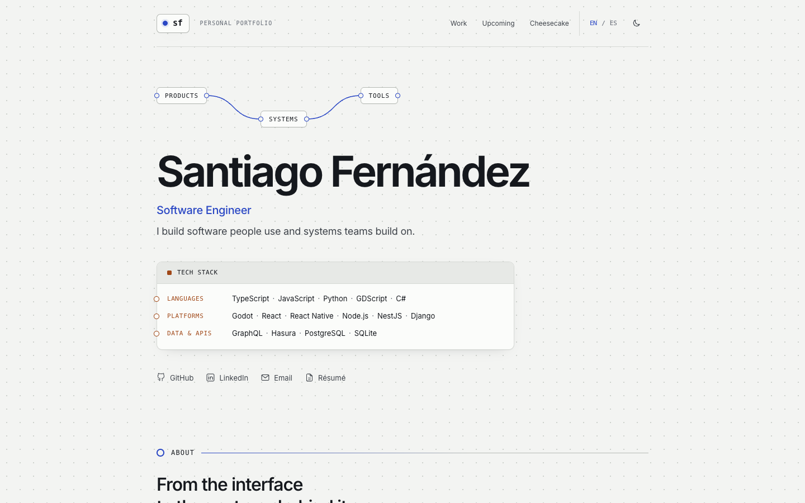

# safernan.dev

[](https://github.com/safernan121/personal-website/actions/workflows/ci.yml)

The source for **[safernan.dev](https://safernan.dev)**, the portfolio of Santiago Fernández, a software engineer in Barcelona. It covers my experience, project write-ups with engineering deep dives, an upcoming app, and, for fun, a cheesecake notebook. Every page is available in English and Spanish.



## Built with

- **React 19** and **React Router 7**, with **TypeScript** in strict mode
- **Vite** for development and builds, **CSS Modules** for styling
- **Oxlint**, **TypeScript**, and **`node:test`** rendering tests, run in **GitHub Actions**
- **Cloudflare Workers** static assets for hosting

## Engineering highlights

- **Bilingual by design.** English lives at `/` and Spanish under `/es/`, using the same components and slugs. Interface strings are typed so a missing translation fails type checking (`Record<keyof typeof en, string>`), and the tests check content parity and that every internal link stays in the current language.
- **Content as typed data.** All copy lives in TypeScript modules under `src/content/`, and pages render from it. Project pages support optional deep dives (problem, what I built, key decision, outcome, plus a step diagram) defined entirely in data.
- **Locked-down by default.** A strict Content Security Policy blocks inline scripts and style attributes, framing, and form submissions. It's paired with HSTS, cross-origin isolation headers, and a minimal permissions policy. The site makes no third-party requests: the font is self-hosted and there is no analytics.
- **Accessible.** A skip link, focus moved to the main content on navigation, keyboard-operable tabs (arrow keys, Home/End, roving focus), scroll-aware section navigation, and reduced-motion support that turns off the pointer glow and smooth scrolling.
- **Tested rendering.** The tests load the real routes and content through Vite's SSR loader and render pages in both languages with `react-dom/server`, so routing, translations, and links are checked without a browser.
- **Résumé from source.** The linked PDF is generated from `resume/santiago-fernandez-cv.html` with headless Chrome (`npm run cv`), so the CV is versioned alongside the site.

### Trade-offs

The site is a client-rendered single-page app. Crawlers that don't run JavaScript receive the default homepage metadata on every route, and unknown routes show a not-found page with HTTP status 200. Prerendering the routes at build time would fix both, and it's the next improvement I'd make.

## Project structure

```
src/
  content/        Typed page content (English) and content/es/ (Spanish)
  i18n/           Locale detection, localized paths, interface strings
  pages/          Route views: home, about, project, cheesecake, recipe, not found
  components/     Shared UI and CSS Modules
  hooks/          Active-section tracking and per-route metadata
  routes.tsx      Route table, shared by both languages
public/           Static files, security headers (_headers), sitemap, résumé PDF
resume/           Résumé source (HTML → PDF)
tests/            Rendering, routing, and translation tests
docs/CONTENT.md   Content rules, sources, and image attribution
```

## Run it locally

Requires Node 22.12 or newer (`nvm use` reads `.nvmrc`).

```sh
npm ci
npm run dev        # http://localhost:5173
```

| Script | What it does |
| --- | --- |
| `npm run dev` | Start the Vite development server |
| `npm run lint` | Lint with Oxlint |
| `npm run typecheck` | Type-check in strict mode |
| `npm test` | Run the rendering and translation tests |
| `npm run build` | Build the static site into `dist/` |
| `npm run preview` | Serve the production build locally |
| `npm run preview:cloudflare` | Serve the build through Cloudflare's runtime, including `_headers` |
| `npm run cv` | Regenerate the résumé PDF (macOS, Google Chrome) |
| `npm run deploy` | Lint, type-check, build, and deploy to Cloudflare |

CI runs lint, type checking, tests, and the build on every push to `main` and on pull requests.

## Deployment

`wrangler.jsonc` configures a static-assets-only Cloudflare Worker serving `dist/` on `safernan.dev` and `www.safernan.dev`. There is no server, database, or secret. The single-page-application fallback serves `index.html` for app routes, so direct links and reloads work. Deploying requires `npx wrangler login` with access to the domain's Cloudflare account, then `npm run deploy`.

`public/_headers` holds the security policy; Vite's preview server doesn't apply it, so check header changes with `npm run preview:cloudflare`. The npm override pins Sharp (used only by Wrangler's Miniflare) to a patched version for [GHSA-wq5f-xc86-pv6w](https://github.com/lovell/sharp/security/advisories/GHSA-wq5f-xc86-pv6w); remove it once Miniflare ships the fix.

## Content

Editing rules, the review and recipe templates, and the sources for every fact and image are in [docs/CONTENT.md](docs/CONTENT.md). In short: every change is made in both languages, personal contributions are kept separate from product metrics, and shared work is credited.

## License

The code is [MIT licensed](LICENSE). The content, résumé, and personal photos are not: they're © Santiago Fernández, and third-party images belong to their owners. See [NOTICE.md](NOTICE.md) for details. If you reuse the code, please swap in your own content.

The layout is inspired by [Brittany Chiang's portfolio](https://brittanychiang.com); the implementation and content are original.
